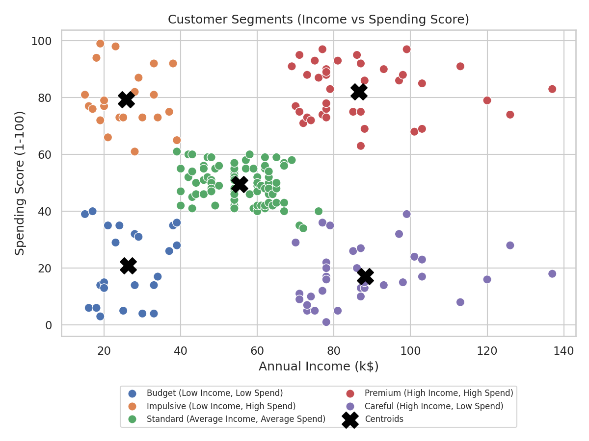
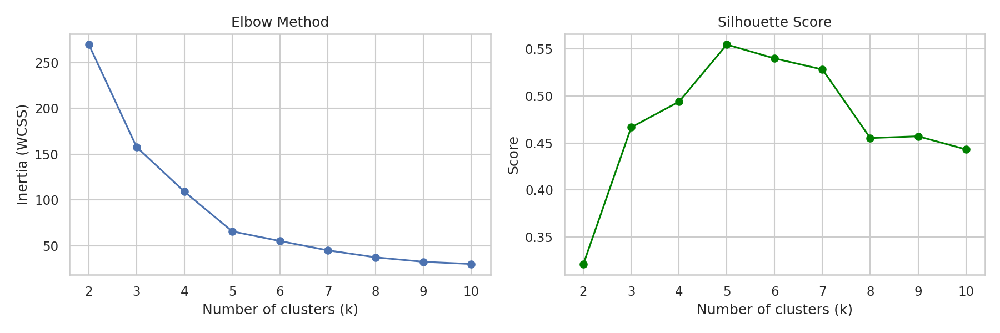
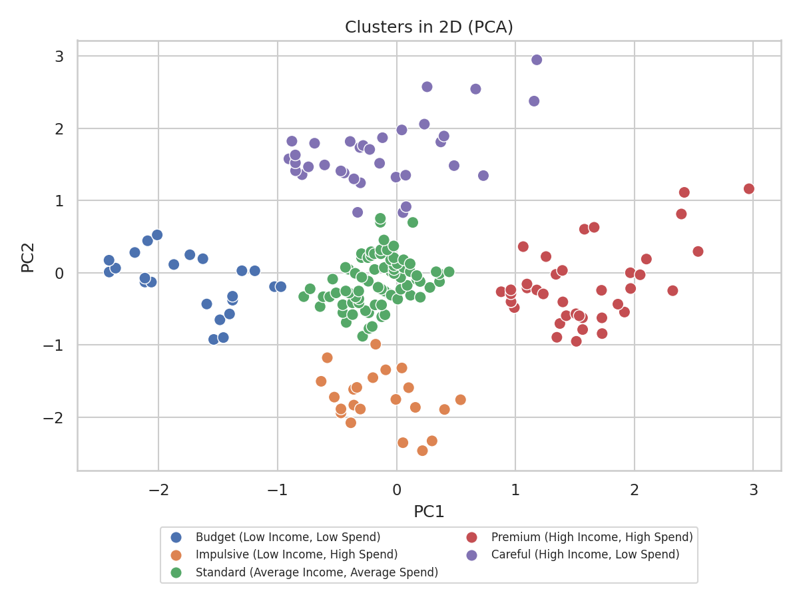
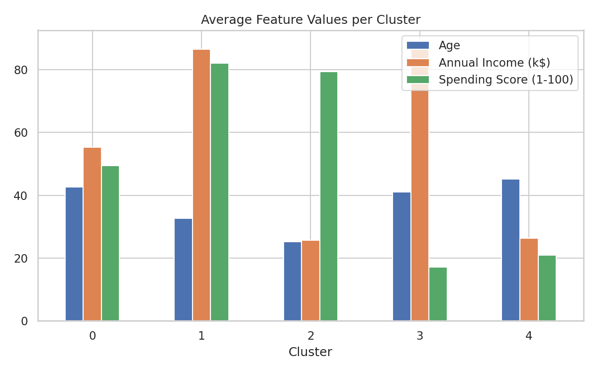

# Customer Segmentation Using K-Means

Group mall customers into meaningful segments with **K-Means clustering**, based on their annual income and spending behaviour, so a business can target each group with the right marketing strategy.

## Problem Statement
Treating all customers the same wastes marketing budget. This project uses unsupervised machine learning to discover natural customer groups and recommend an action for each one.

## Dataset
- Source: Kaggle, **Mall Customer Segmentation Data** (`data/Mall_Customers.csv`)
- 200 customers, no missing values, no duplicate rows
- Columns: `CustomerID`, `Gender`, `Age`, `Annual Income (k$)`, `Spending Score (1-100)`

## Tech Stack
Python, Pandas, NumPy, Scikit-learn, Matplotlib, Seaborn, Jupyter Notebook

## Methodology
1. **Data checks**: missing values, duplicates, summary statistics
2. **EDA**: distributions, gender split, correlation heatmap
3. **Scaling**: `StandardScaler`, because K-Means is distance based
4. **Choosing k**: Elbow method (inertia) and Silhouette score
5. **Model**: K-Means on Annual Income and Spending Score (Age is used to profile the segments)
6. **Profiling**: average values per cluster and business-friendly segment names
7. **Visualisation**: scatter plot with centroids and a 2D PCA view

## Results
Best number of clusters: **k = 5** (silhouette score = 0.555)

| Segment | Customers | Avg Age | Avg Income (k$) | Avg Spending Score |
|---|---|---|---|---|
| Premium (High Income, High Spend) | 39 | 32.7 | 86.5 | 82.1 |
| Careful (High Income, Low Spend) | 35 | 41.1 | 88.2 | 17.1 |
| Impulsive (Low Income, High Spend) | 22 | 25.3 | 25.7 | 79.4 |
| Budget (Low Income, Low Spend) | 23 | 45.2 | 26.3 | 20.9 |
| Standard (Average Income, Average Spend) | 81 | 42.7 | 55.3 | 49.5 |

Key observations:
- The largest group (81 customers, 40%) is the **Standard** segment with average income and spending.
- **Impulsive** buyers are the youngest group (avg age about 25) and spend a lot despite low income.
- **Careful** customers have high income but very low spending, so they are the biggest opportunity for growth.

### Visuals





## Business Recommendations
- **Premium**: VIP loyalty program, early access to new products, premium services.
- **Careful**: personalised offers and reminders; investigate what would make them spend more.
- **Impulsive**: flash sales, limited-time deals, bundles, EMI/instalment options.
- **Standard**: regular promotions, upselling and cross-selling.
- **Budget**: discount coupons and low-cost entry products; keep marketing spend low.

## Project Structure
```
customer-segmentation-kmeans/
├── data/
│   └── Mall_Customers.csv
├── notebooks/
│   └── customer_segmentation.ipynb
├── src/
│   └── segmentation.py
├── images/                  # generated charts
├── results/                 # cluster_profile.csv, customers_with_clusters.csv
├── requirements.txt
├── .gitignore
├── LICENSE
└── README.md
```

## How to Run
```bash
git clone <this-repository-url>
cd customer-segmentation-kmeans

python -m venv venv
venv\Scripts\activate          # Windows
# source venv/bin/activate     # Mac / Linux

pip install -r requirements.txt

python src/segmentation.py     # runs the full pipeline, saves charts and results
```

To explore step by step in the notebook:
```bash
pip install jupyter
jupyter notebook notebooks/customer_segmentation.ipynb
```

## Future Improvements
- Try other algorithms: DBSCAN, Hierarchical, Gaussian Mixture
- Add behavioural features (purchase frequency, recency, basket size)
- Build a Streamlit app that predicts the segment of a new customer

## License
MIT License. See [LICENSE](LICENSE).
